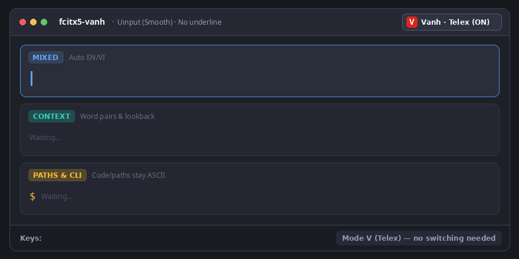
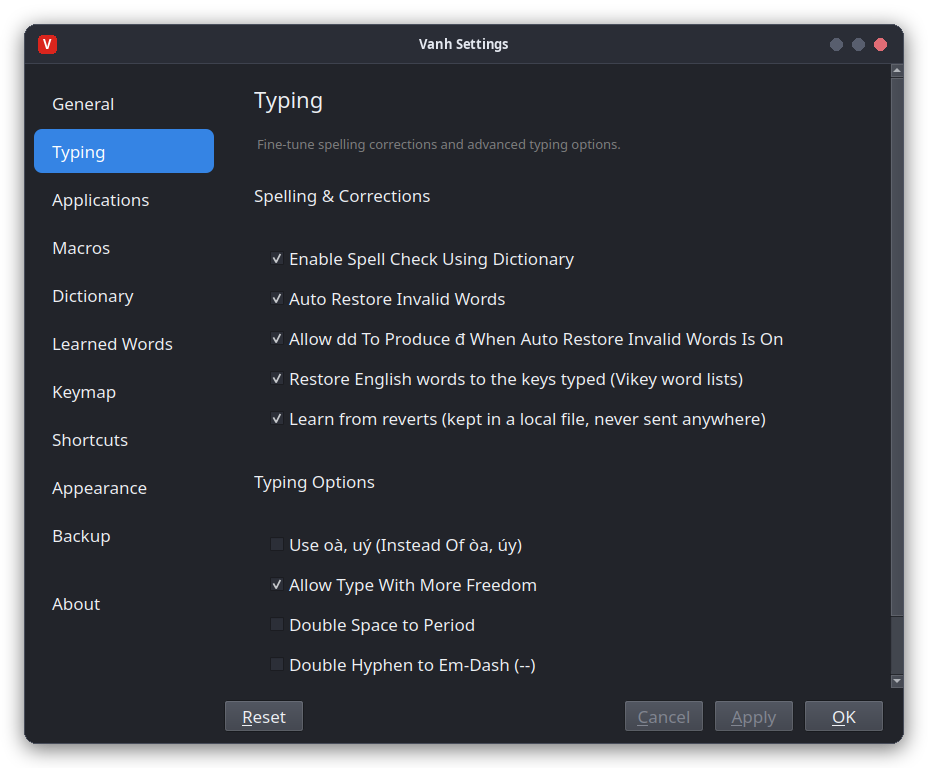

[English](README.en.md) | [Tiếng Việt](README.md)

# Vanh

**Vanh** (Việt + Anh, "Vietnamese + English") is a Vietnamese input method for fcitx5 on Linux. It lets you mix Vietnamese and English in the same text without switching modes, types without underline, and does not drop or double letters when you type fast. Vanh is a fork of [fcitx5-lotus](https://github.com/LotusInputMethod/fcitx5-lotus).



## Features

- **Automatic English/Vietnamese switching.** At the end of a word, if the keys you typed are an English word, Vanh puts them back as typed: `test` stays "test" instead of "tét", and `error` stays "error" instead of "eror". Vietnamese words are kept: `cos` → "có".
- **Context.** For a word that reads both ways, the word next to it decides (`cho con bus` → "cho con bú", while `the bus` stays). An earlier word is fixed when the next one makes it clear: `thí makes` → "this makes".
- **Typing without underline.** Letters go straight into the field, as on Windows, with no underlined text waiting to be confirmed.
- **No dropped or doubled letters when typing fast** in Chrome/Brave (the address bar too), Facebook and GNOME apps: Vanh uses surrounding text when the app supports it, waits for the app to catch up before fixing a word, and switches to uinput when the app drops deletions (Messenger, Apple Notes on the web). Terminals keep using uinput.
- Everything else from lotus: Telex/VNI and other input methods, macros, dictionary, charsets, emoji.

The package, addon, input method, server and config files are named `vanh` (`fcitx5-vanh`, `fcitx5-vanh-server@<user>.service`, `~/.config/fcitx5/conf/vanh.conf`). The `fcitx5-vanh` package replaces `fcitx5-lotus`; on the first start Vanh copies an existing lotus configuration (config, macros, keymap, app rules, emoji history, user dictionary) to the new names and puts Vanh in place of lotus in the input method list. The old files are kept.

## Install with apt (Debian/Ubuntu)

The apt repository has amd64 packages for Ubuntu 22.04, 24.04, 25.10, 26.04, 26.10 and Debian 12, 13, testing, unstable. Add it once; later versions arrive through `sudo apt upgrade`. Single `.deb` files are on the [Releases](https://github.com/congmnguyen/fcitx5-vanh/releases) page.

```bash
url=https://congmnguyen.github.io/fcitx5-vanh key=/usr/share/keyrings/fcitx5-vanh.asc
sudo wget -O $key $url/key.asc
echo "deb [arch=amd64 signed-by=$key] $url $(. /etc/os-release; echo ${UBUNTU_CODENAME:-$VERSION_CODENAME}) main" \
  | sudo tee /etc/apt/sources.list.d/fcitx5-vanh.list
sudo apt update && sudo apt install fcitx5-vanh
im-config -n fcitx5
```

The package enables the `fcitx5-vanh-server@<user>` server for the logged-in users. Log out and back in, open Fcitx5 Configuration (`fcitx5-configtool`) and add **Vanh** to the input method list.

## Build from source (Debian/Ubuntu)

```bash
sudo apt install --no-install-recommends debhelper dh-python cmake g++ extra-cmake-modules fcitx5-modules-dev \
  libfcitx5core-dev libfcitx5config-dev libfcitx5utils-dev libinput-dev libnotify-dev \
  libdbus-1-dev libsystemd-dev libudev-dev pkg-config python3 gettext cargo rustc
git clone https://github.com/congmnguyen/fcitx5-vanh && cd fcitx5-vanh
cp -r packaging/debian debian && dpkg-buildpackage -b -us -uc -j$(nproc) && rm -rf debian obj-*
sudo apt install ../fcitx5-vanh_*_amd64.deb python3-pyqt5
fcitx5 -r -d
```

Other distros (`cargo` and `rustc` are needed too): `cmake -DCMAKE_INSTALL_PREFIX=/usr . && make && sudo make install` with the matching dev packages.

## Usage

- **Typing modes.** The `` ` `` key opens the mode menu: Uinput (Smooth), Uinput (Super Smooth), Uinput (Select), Surrounding Text, Preedit, Emoji Picker, OFF. On the first start, Vanh selects Uinput (Smooth) automatically when the `fcitx5-vanh-server@<user>` server is running, and falls back to Preedit otherwise.
- **Revert.** `Shift+BackSpace` turns the last word to its other reading (English ↔ Vietnamese) when Vanh guessed wrong.
- **Settings.** `fcitx5-vanh-settings` edits the input method, charset, hotkeys (including one-click `Super + Space` setup on GNOME so Activities Overview is never triggered accidentally), macros, learned words, the user dictionary, a custom keymap, and backs up or restores the configuration.
- **App rules.** The mode menu can assign a mode to the app in use; the rules are kept in `~/.config/fcitx5/conf/vanh-app-rules.conf`.



## Accuracy

The public corpus [`engine-rs/eval/public.tsv`](engine-rs/eval/public.tsv) has 179 mixed Vietnamese/English sentences (1430 words), including commands, paths, URLs, identifiers and words that read both ways, typed back as Telex through the engine; on every build `ctest` checks that the number of wrong words has not changed.

| Configuration | Wrong words | Per 1000 words |
|---|---|---|
| Vanh (default) | 0 | 0.00 |
| Restore of misspelled words only (bamboo style) | 47 | 32.87 |
| Plain Telex | 177 | 123.78 |

The corpus is small, written for this measurement and has 45 code tokens, so it is easier than real text. To run it again:

```bash
cd engine-rs && cargo run --release --example replay -- run eval/public.tsv --split all --config default
```

`--config bamboo` and `--config off` give the other two rows.

## Troubleshooting

- **"The uinput server is not running" notification.** Check `systemctl status fcitx5-vanh-server@$USER`; if it is not enabled, run `sudo systemctl enable --now fcitx5-vanh-server@$USER`. While the server runs, `/run/vanh/$USER/` holds `kb.sock` and `mouse.sock`.
- **The server cannot open `/dev/uinput`.** `getfacl /dev/uinput` must list `user:uinput_proxy:rw-`. If it does not: `sudo modprobe uinput && sudo udevadm trigger --subsystem-match=misc --sysname-match=uinput`.
- **Logs.** Server: `journalctl -u fcitx5-vanh-server@$USER -e`. Input method: run `fcitx5 -r --verbose=vanh=5` in a terminal.
- **An app drops or doubles letters.** Try another mode for that app in the mode menu, then [open an issue](https://github.com/congmnguyen/fcitx5-vanh/issues/new/choose) with the app, its version, the desktop and X11 or Wayland.

## Contributing

Building, testing and linting are described in [`CONTRIBUTING.md`](CONTRIBUTING.md); the changes of each release in [`CHANGELOG.md`](CHANGELOG.md).

## License and credits

GPL-3.0-or-later, see [`LICENSE`](LICENSE). Vanh builds on:

- **[fcitx5-lotus](https://github.com/LotusInputMethod/fcitx5-lotus)** (GPL-3.0-or-later), itself a fork of **[VMK](https://github.com/thanhpy2009/VMK)**.
- **[bamboo-core](https://github.com/BambooEngine/bamboo-core)**: the original typing engine, MIT, © 2018 Luong Thanh Lam ([`engine-rs/LICENSE.bamboo-core`](engine-rs/LICENSE.bamboo-core)).
- **[fcitx5-bamboo](https://github.com/fcitx/fcitx5-bamboo)**: the fcitx5 glue is based on it, LGPL-2.1.
- **[Vikey](https://github.com/tonyminibot/Vikey)** (GPL-3.0): word lists, frequencies and word pairs for English/Vietnamese switching. Original data sources: FrequencyWords/OpenSubtitles 2018 (CC BY-SA 4.0), FineWeb-2/FineWeb and MADLAD-400 (ODC-By), HPLT 2 (CC0).

Full credits in [`CREDITS`](CREDITS).
